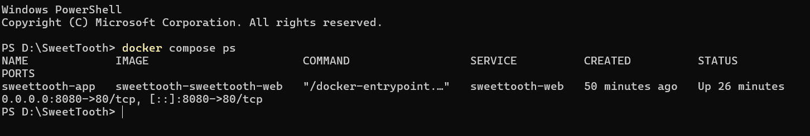
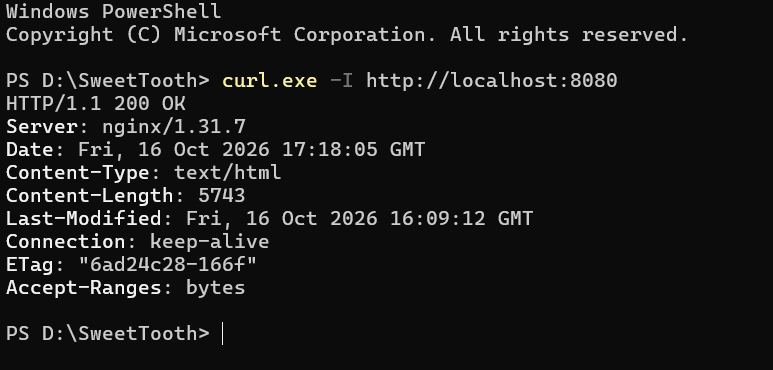
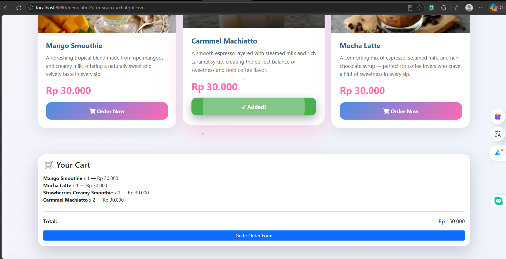
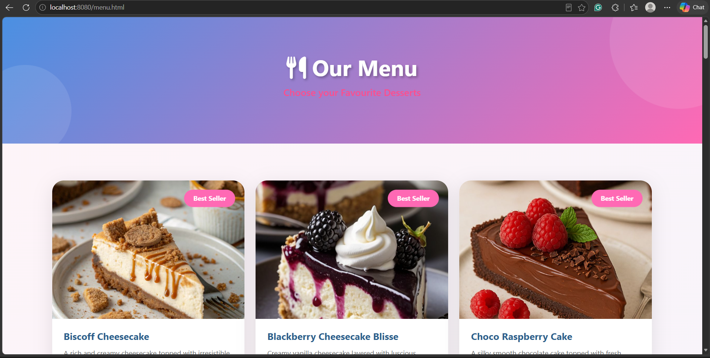
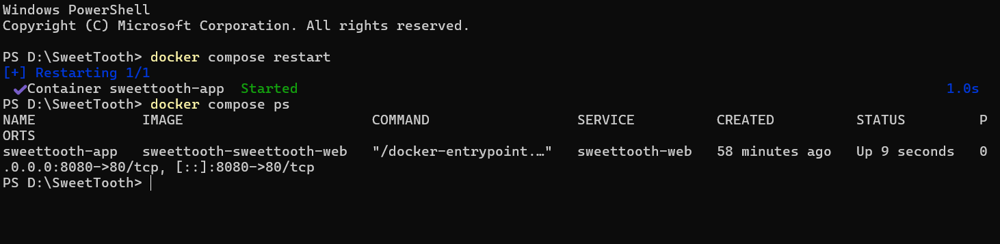

# Functional Verification Matrix & QA Report

**Project:** SweetTooth  
**Tester:** Naw Ngone Thitsar 
**Role:** QA & Verification Lead  
**Date:** 17 October 2026  
**Git Branch:** `chore/dockerize-project`

---

## 1. Objective

The objective of this verification is to check whether the SweetTooth website runs correctly in Docker, whether the menu and shopping cart work as expected, and whether the website remains accessible after restarting the container.

## 2. Runtime Environment

- **Operating System:** Windows
- **Container Platform:** Docker Desktop
- **Base Image:** `nginx:alpine`
- **Container Name:** `sweettooth-app`
- **Application URL:** `http://localhost:8080`
- **Project Directory:** `D:\SweetTooth`

## 3. Container Health and Runtime Inspection

The Docker container was started using Docker Compose. The container status was inspected using the following command:

```powershell
docker compose ps
```

**Actual Result:** The `sweettooth-app` container was running with status `Up`. Port `8080` on the host was mapped to port `80` in the container.

**Status:** PASS

*Note: The container was confirmed to be running. A separate Docker healthcheck result was not verified.*

## 4. Functional Verification Matrix

| Test ID | Test Case | Expected Result | Actual Result | Status |
|---|---|---|---|---|
| V-01 | Container status | Container starts and remains running | `sweettooth-app` showed status `Up` with port mapping `8080->80` | PASS |
| V-02 | HTTP response | Website returns HTTP 200 OK | `curl.exe -I http://localhost:8080` returned `HTTP/1.1 200 OK` | PASS |
| V-03 | Menu and shopping cart | Items can be added and the total updates correctly | Four items were displayed in the cart with a total of Rp 120.000 | PASS |
| V-04 | Container restart | Website remains accessible after restarting the container | Container restarted successfully and the menu page loaded after browser refresh | PASS |

## 5. Test Procedures and Results

### V-01: Container Status

**Procedure:**
1. Open the terminal in the SweetTooth project directory.
2. Run `docker compose ps`.
3. Inspect the container status and port mapping.

**Result:** The `sweettooth-app` container was running, and port `8080` was mapped to port `80`.

**Status:** PASS

### V-02: HTTP Response

**Procedure:**
1. Open the terminal.
2. Run the command below:

```powershell
curl.exe -I http://localhost:8080
```

3. Check the HTTP status response.

**Result:** The server returned `HTTP/1.1 200 OK`, confirming that the website responded successfully.

**Status:** PASS

### V-03: Menu and Shopping Cart

**Procedure:**
1. Open `http://localhost:8080/menu.html` in a browser.
2. Add menu items to the shopping cart.
3. Check the displayed items and total price.

**Result:** Four items appeared in the shopping cart, and the displayed total was Rp 120.000. The total matched the sum of the four item prices shown on the menu.

**Status:** PASS

### V-04: Container Restart

**Procedure:**
1. Run `docker compose restart`.
2. Run `docker compose ps` to check the container status.
3. Refresh `http://localhost:8080/menu.html` in the browser.

**Result:** The container restarted successfully, its status showed `Up`, and the menu page loaded after refreshing the browser.

**Status:** PASS

## 6. Evidence and Screenshots

The following screenshots show the actual test results.

**V-01: Container status**



**V-02: HTTP response**



**V-03: Shopping cart**



**V-04: Container restart**





## 7. Troubleshooting Reflection

During the initial attempt, Docker could not connect to the Docker Desktop Linux engine. After retrying, the image built successfully and the container started.

**Lesson learned:** Docker Desktop must be running and its engine must be available before starting containers. Docker Compose commands can be used to start, inspect, and restart the application.

## 8. Limitations

This verification covered container status, HTTP response, shopping cart display and total calculation, and website availability after restarting the container.

It did not verify database persistence, backend order processing, or a separate Docker healthcheck. These should not be considered tested or passed based on the current evidence.

## 9. Conclusion

The SweetTooth website was successfully served through Docker at `http://localhost:8080`. The container was running, the HTTP response was successful, the shopping cart displayed four items totaling Rp 120.000, and the website loaded after the container restart.

The verification results support that the tested website functions were working during the test session.

**Prepared by:** Serina  
**Role:** QA & Verification Lead  
**Project:** SweetTooth DevOps